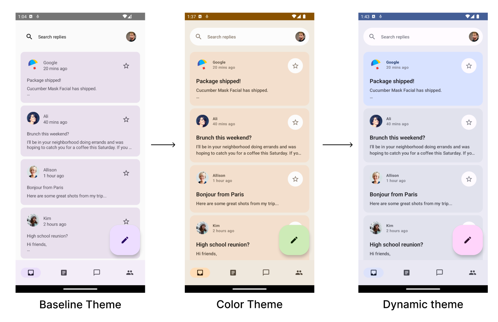

# Theming in Compose with Material 3 Codelab

This folder contains the source code for
the [Theming in Compose with Material 3 Codelab](https://developer.android.com/codelabs/jetpack-compose-theming)

## Screenshots



## License

```

GPL 3.0

```
